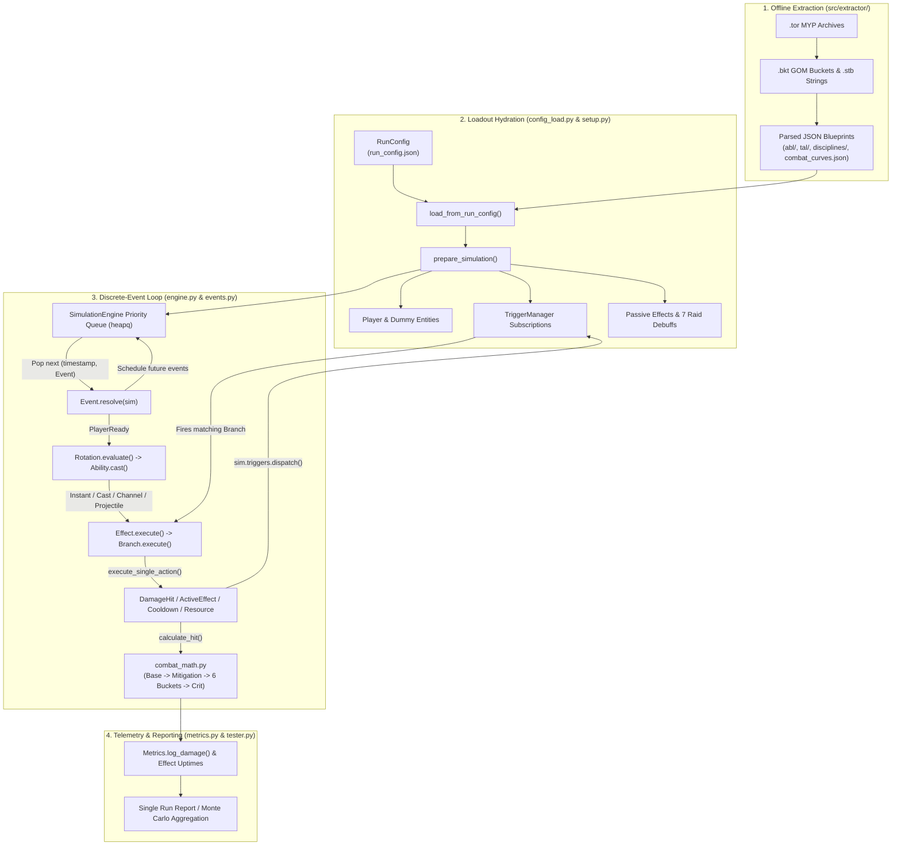

# SwtorSim Technical Architecture

**SwtorSim** is a discrete-event combat simulation engine driven by parsed SWTOR Game Object Model (GOM) blueprints. Rather than ticking on a fixed time-step (e.g. every `0.01s`), the engine jumps directly from one discrete event timestamp to the next using a min-heap priority queue (`heapq`).

---

## 1. End-to-End Architecture & Data Flow

---

## 2. Phase 1: Configuration & Blueprint Hydration

### `RunConfig` & `load_from_run_config` (`src/swtorsim/run_config.py`, `src/swtorsim/config_load.py`)

1. **`validate_run_config(config)`**: Validates paths, ensures the Tactical FQN starts with `abl.itm.tactical.`, verifies that 2 distinct Legendary Implants (`abl.itm.legendary.*`) and up to 2 Relics (`abl.itm.relic.*`) are selected, and synchronizes global settings (`settings.py`):
   - `set_data_environment(config.environment)` (`"live"` vs `"pts"`)
   - `set_stem_matching(config.enable_stem_matching)`
   - `set_projectile_flight_time(config.enable_projectile_flight_time)`
   - `set_default_combat_distance(config.default_combat_distance)`
   - `set_in_flashpoint_operation(config.in_flashpoint_operation)`
2. **`selected_fqns_from_config(config)`**: Combines:
   - Baseline discipline `active_abilities` and `passive_abilities`
   - Skill-tree selections resolved via `resolve_skill_tree_fqns()` (applying `"replaces"` swaps where higher-tier abilities replace base abilities)
   - Equipped `tactical_fqn`, `legendary_fqns`, and `relic_fqns`
3. **`load_complete_loadout(fqns)`**: Converts each dot-separated FQN (e.g. `abl.sith_inquisitor.skill.hatred.demolish`) into its filesystem path (`data/extractor/parsed/abl/sith_inquisitor/skill/hatred/demolish.json`) and hydrates it into an immutable **`AbilityBlueprint`** hierarchy:
   - **`AbilityBlueprint`**: Holds ability metadata (`fqn`, `name`, `type`, `energy_cost`, `base_gcd`, `cooldown`, `triggers_gcd`, `tags`, `max_charges`, `abl_ignore_alacrity`, `activation`, `conditions`, `stat_changes`, `entry_effect_ids`) and a map of **`Effect`** objects (`effects: dict[int, Effect]`).
   - **`Effect`**: Represents a numbered GOM sub-effect (`number`, `entry`, `duration`, `tick_interval`, `eff_ignore_alacrity`, `is_passive`, `name`, `tags`, `stack_charge`, `conditions`, `target_overrides`, `initializers`) and a list of **`Branch`** objects.
     - `Effect.is_persistent` is `True` when `duration > 0.0` or `is_passive == True` (via `eff_initializer__set_passive`). Otherwise `Effect.is_instant` is `True`.
   - **`Branch`**: Holds `index`, `triggers`, `conditions`, `actions`, `target_overrides`, `run_if_none_ran`, and `is_attack`.

---

## 3. Phase 2: Simulation Setup (`src/swtorsim/setup.py`)

`prepare_simulation(rotation_config, stats_config, loadout_blueprints, dummy_hp, debuff_module, verbose)` initializes a clean, isolated simulation instance:

1. **Engine & Entity Instantiation**:
   - Creates `SimulationEngine(verbose=verbose)` and attaches a `TriggerManager` (`sim.triggers`).
   - Creates the `Player` entity (`entities.py`), populating `player.raw_stats` from `stats_config`, instantiating the class-appropriate `ResourcePool` (`Force`, `Energy`, `Heat`, or `Rage`/`Focus`), and calling `player.recalculate_stats()`.
   - Creates the `Dummy` target entity (`entities.py`) with `dummy_hp` and `combat_distance`.
2. **Ability Database Construction**:
   - Wraps every `AbilityBlueprint` in a runtime **`Ability`** instance (`abilities.py`).
   - Indexes each `Ability` in `player.ability_db` under three keys so rotations, procs, and GOM actions can look up abilities by any identifier:
     1. Full FQN (`"abl.sith_inquisitor.skill.hatred.assassinate_plus"`)
     2. Display Name (`"Assassinate+"`)
     3. Normalized Slug (`"assassinate+"`, lowercase with spaces replaced by `_`)
3. **Passive Hydration, Proc Registry, & Trigger Subscription**:
   - `build_proc_registry(loadout_blueprints)` populates `player.proc_registry`, mapping canonical proc names (e.g. `"Bloodletting"`, `"Raze"`, `"Languishing Lashes"`) to their exact runtime lockout effect name (`"Bloodletting_3"`, `"Raze_4"`) or `trigger_icd` source FQN, sharing the exact classification rules used by the Rotation Builder catalog.
   - For every blueprint in `loadout_blueprints`:
     - If `blueprint.type == "passive"`, applies its top-level `stat_changes` and persistent sub-effects as permanent `ActiveEffect` instances on `player` (`expires_at=None`) and calls `player.recalculate_stats()`.
     - Subscribes all event-bus triggers (`on_damage_dealt`, `on_ability_activate`, `on_enter_combat`, etc.) from passive branches into `sim.triggers`.
     - Schedules any periodic passive timers via `schedule_periodic()`.
4. **Operations Training Dummy Raid Debuffs**:
   - When `training_dummy_armor_debuff` is enabled, `load_training_dummy_armor_debuffs()` splits the game's `training_dummy_armor_debuff.json` blueprint into the **7 canonical SWTOR raid debuffs** on the `Dummy` target:
     1. **Sundered (Physical)**: `-20%` Armor Rating (`STAT_rtg_armor`)
     2. **Beat Down (Physical)**: `+5%` Melee Damage Taken (`stat_cbt_damage_taken_scale_channel_melee_modifier_percentage`)
     3. **Marked (Physical)**: `+5%` Ranged Damage Taken (`stat_cbt_damage_taken_scale_channel_ranged_modifier_percentage`)
     4. **Vulnerable (Force)**: `+5%` Force Damage Taken (`stat_cbt_damage_taken_scale_channel_force_modifier_percentage`)
     5. **Susceptible (Tech)**: `+5%` Tech Damage Taken (`stat_cbt_damage_taken_scale_channel_tech_modifier_percentage`)
     6. **Assailable (Mental)**: `+7%` Elemental & Internal Damage Taken (`stat_cbt_damage_taken_scale_type_elemental_modifier_percentage`, `stat_cbt_damage_taken_scale_type_internal_modifier_percentage`)
     7. **Overwhelmed (Mental)**: `+10%` AoE Damage Taken (`STAT_cbt_damage_received_modifier_percentage`, gated by `tag.abl.Attack.is_aoe` / `aoe_ability`)
5. **Initial Timeline Seeding**:
   - Schedules `ResourceTick(player, interval=1.0)` at `t = 1.0s`.
   - Schedules `PlayerReady(player, target)` at `t = 0.0s`.

---

## 4. Phase 3: Discrete-Event Engine & Timeline Events

### `SimulationEngine` (`src/swtorsim/engine.py`)

`SimulationEngine` maintains:
- `current_time: float` (starts at `0.0`)
- `event_queue: list[tuple[float, Event]]` (managed via `heapq.heappush` / `heapq.heappop`)
- `tracker: Metrics`
- `triggers: TriggerManager`

When two events are scheduled for the exact same timestamp, `Event.__lt__` returns `False`, preserving insertion order without raising comparison errors on `Event` instances.

`run_timed(duration, target)` loops while `event_queue` is non-empty:
1. Pops `(timestamp, event)`.
2. Stops if `timestamp > duration` or `target.hp <= 0`.
3. Advances `self.current_time = timestamp` and calls `event.resolve(self)`.
4. After the loop terminates, calls `self.tracker.finalize(self.current_time)` to close out any buffs/debuffs still active at the end of the fight.

### Event Catalog (`src/swtorsim/events.py`)

| Event Class | Triggered / Scheduled By | Resolution Behavior |
| :--- | :--- | :--- |
| **`PlayerReady`** | `prepare_simulation` (`t=0`), `CastFinishEvent`, `ChannelTickEvent`, or self-retry (`+0.1s`) | Calls `player.rotation.evaluate(player, target, sim)`. If an ability acted, schedules the next `PlayerReady` at `max(sim.current_time, player.next_gcd)`. If blocked (waiting on cooldown/resource), retries in `+0.1s`. |
| **`AbilityCast`** | Queued cast helper | Calls `Ability.cast(ability, source, target, sim)`. |
| **`CastFinishEvent`** | `Ability.cast` (when `activation.type == "cast"` and `duration > 0`) | Verifies `caster.active_cast is self.ability`, clears casting state, executes all `entry_effect_ids`, dispatches `on_ability_post_activate`, and schedules `PlayerReady`. |
| **`ChannelTickEvent`** | `Ability._start_channel` and self-rescheduling | Verifies `source.active_channel is self.channel`, increments `current_tick`, decrements `remaining_ticks`, executes `on_tick` branches across all ability effects, and either schedules the next tick or finishes the channel (dispatching `on_channeling_ended` and calling `cleanup_channel_effects`). |
| **`ProjectileImpactEvent`** | `handle_invoke_projectile` (`abilities.py`) | Fires when a distance-based or fixed-time projectile reaches the target, executing `on_travel_complete` branches on the parent `Effect`. |
| **`DelayedBranchEvent`** | `Effect.schedule_timer_branches` (`on_timer_expired`) | Executes a delayed branch (e.g., secondary strikes or delayed detonations) at `current_time + delay`. |
| **`DamageHit`** | `handle_damage_action` (`abilities.py`) | Calls `calculate_hit(source, target, action_with_ctx)`, dispatches `on_pre_damage_dealt` / `on_pre_damage_taken`, resolves `ApplyDamageLand`, breaks stealth if non-periodic, and dispatches `on_damage_dealt` / `on_damage_taken`. |
| **`ApplyDamageLand`** | `DamageHit.resolve` | Logs damage into `sim.tracker`, subtracts `final_damage` from `target.hp`, and if `target.hp <= 0` marks target dead and dispatches `on_pre_death`, `on_death`, and `on_kill`. |
| **`DotTick`** | `Entity.apply_effect` (when `tick_interval > 0`) and self-rescheduling | Verifies the effect instance hasn't expired or been overwritten, computes `current_tick` and `stack_multiplier`, executes `on_tick` branches on the `Effect`, decrements `ticks_remaining`, and either reschedules at `+tick_interval` or cleans up the expired DoT/HoT. |
| **`EffectExpire`** | `Entity.apply_effect`, `handle_reset_timer`, `handle_modify_active_duration` | Verifies `entity.effects.get(effect_name) is self.instance_ref`, executes `on_pre_remove` branches on the blueprint, and removes the effect via `entity.cleanup_expired_effects()`. |
| **`ChargeRestoreEvent`** | `Ability.apply_cooldown_locks` / `Ability.restore_charge` | Restores 1 ability charge when `ability.active_charge_event is self`, rescheduling itself if `charges < max_charges`. |
| **`ResourceTick`** | `prepare_simulation` (`t=1.0s`) and self-rescheduling (`+1.0s`) | Computes `alacrity_mod = 1.0 + Alacrity`, ticks passive regeneration on `player.resource`, and schedules the next tick in `1.0s`. |
| **`ResourceGainEvent`** | `handle_resource_gain_action` (with `delay > 0`) | Calls `player.resource.generate(amount)`. |

---

## 5. Phase 4: Ability Execution & Action Dispatch (`src/swtorsim/abilities.py`)

### 5.1 `Ability.cast(caster, target, sim)`

When a rotation step invokes `ability.cast(caster, target, sim)`:

1. **Pre-Checks (`can_cast`)**:
   - Rejects if `caster.is_casting` is `True`.
   - If `triggers_gcd` is `True`, verifies `sim.current_time >= caster.next_gcd`.
   - For multi-charge abilities (`max_charges`), checks `charges >= 1`; for standard abilities, checks `sim.current_time >= caster.cooldowns.get(name, 0.0)`.
   - Computes modified resource cost via `caster.calculate_resource_cost(name, energy_cost, apply=False)` and checks `caster.resource.can_afford(cost)`.
   - Evaluates top-level ability `conditions` via `validate_all()`.
2. **Channel Clipping**:
   - If `caster.is_channeling` is `True`, casting a new ability clips the active channel (`old_channel.is_finished = True`), cleans up channel-bound effects, and dispatches `on_channeling_ended` with `is_successful: False`.
3. **Resource Spend & Cooldown / GCD Locks**:
   - Deducts `final_spend` (consuming single-use cost-reduction buffs when `apply=True`).
   - Calls `apply_cooldown_locks(caster, sim)` to update `caster.next_gcd` (if `triggers_gcd`) and either lock `caster.cooldowns[name]` or consume a charge and schedule `ChargeRestoreEvent`.
4. **Pre-Activation Trigger & Combat State**:
   - Dispatches `on_ability_activate` on `sim.triggers`.
   - Determines if the ability is aggressive (`tag.abl.utility.aggressive_action`, `is_basic_attack`, or has attack branches). Aggressive abilities break stealth, put the caster in combat (dispatching `on_enter_combat` on initial entry), and target the enemy `Dummy`; non-aggressive abilities default their initial target to `caster`.
5. **Activation Routing**:
   - **Channeled (`activation.type == "channel"`)**: Calls `_start_channel()`, creating an `ActiveChannel`, executing `entry_effect_ids` immediately for the initial impact, and scheduling the first `ChannelTickEvent`.
   - **Cast-Time (`activation.type == "cast"` with `scaled_cast_time > 0`)**: Sets `caster.is_casting = True` and schedules `CastFinishEvent` at `current_time + scaled_cast_time`.
   - **Instant**: Immediately executes all `entry_effect_ids` via `self.execute_effect()` and dispatches `on_ability_post_activate`.

### 5.2 `Effect.execute` and `Branch.execute`

When an `Effect` executes:
- Resolves `target_overrides` (`caster`, `primary_target`, `aoe_sphere`, `aoe_cone`, `party_members`, `trigger_target`, `trigger_caster`).
- Validates effect-level `conditions` and checks target immunity (`effect_target.is_immune_to_effect(self)`).
- **Persistent Effects (`duration > 0` or `is_passive`)**:
  - Applies or refreshes the `ActiveEffect` on `effect_target` via `effect_target.apply_effect(sim, ability, self, caster)`.
  - Fires `on_refresh` (if refreshed) or `on_apply` (if newly applied) branches.
  - If stacks increased on refresh, fires `on_stack_charge_increased` branches and dispatches `on_stack_charge_increased` on `sim.triggers`.
  - Schedules any `on_timer_expired` delayed branches.
- **Instant Effects (`duration == 0` and not passive)**:
  - Executes all `on_apply` and untriggered branches immediately and schedules any `on_timer_expired` branches.

Inside `Branch.execute`:
- Evaluates branch `conditions` via `validate_all()`.
- Iterates through `self.actions`. Actions gated by `combat_math_only` or `results` (`HIT_RESULTS = {"effResultOk", "effResultGlance", "effResultCrit"}` or `FAIL_RESULTS = {"effResultMiss", "effResultImmune", "effResultResisted"}`) inspect the outcomes of prior `"damage"` actions in the same branch before running!
  - For example, secondary effects that require a critical hit (`results: ["effResultCrit"]`) only execute if the preceding damage action in the branch critically hit.

### 5.3 Action Handlers (`execute_single_action`)

| Action Type(s) | Handler Function | Description |
| :--- | :--- | :--- |
| `"damage"` | `handle_damage_action` | Rolls accuracy (`accuracy_roll`), splits dual-wield/flurry hits, and resolves or schedules `DamageHit`. Returns `_DamageActionResult(landed, crit=is_crit)`. |
| `"apply_effect"`, `"buff"`, `"debuff"`, `"dot"` | `handle_apply_effect` | Resolves a sub-effect by `effect_id` on the current or referenced ability and calls `Effect.execute()`. |
| `"resource_gain"`, `"energy_recovery"`, `"regen_force"`, `"regen_energy"`, `"restore_action_points"` | `handle_resource_gain_action` | Generates resource on `caster.resource` (scaling by `stack_multiplier` if `scales_with_stack_charge` is set). |
| `"spend_energy"`, `"spend_force"` | `handle_resource_spend_action` | Spends resource from `caster.resource`. |
| `"cooldown_mod"`, `"modify_cooldown"`, `"modify_recharge_time"` | `handle_cooldown_modification` | Modifies remaining cooldowns or active charge recharge timers on abilities matching FQN or tags (supports flat delta and percentage reduction). |
| `"grant_charge"`, `"modify_ability_stack_charge"` | `handle_restore_charge` | Grants ability charges (`restore_charge`) or consumes charges if negative. |
| `"modify_stack_charge"` | `handle_modify_stack_charge` | Adds or removes stacks (`ActiveEffect.modify_stacks`) on active effects matching tags or `owner_effect_key`. |
| `"set_effect_stack_charge"` | `handle_set_effect_stack_charge` | Sets exact stack count (`ActiveEffect.set_stacks`) on a target effect (applying the effect first if not yet active). |
| `"buff_remove"`, `"remove_effect"`, `"dispel"` | `handle_buff_remove_action` | Removes active effects matching name, FQN, or tags, firing their `on_pre_remove` branches first. |
| `"execute_ability"` | `handle_execute_ability` | Programmatically fires another ability's `entry_effect_ids` (used by proc-triggered abilities and talent hooks). |
| `"invoke_projectile"` | `handle_invoke_projectile` | Computes projectile flight time (fixed interval `"41"` for timed projectiles or `distance / (travel_speed * 10.0)`) and schedules `ProjectileImpactEvent`. |
| `"reset_timer"` | `handle_reset_timer` | Resets an active effect's `expires_at` and `ticks_remaining` back to full duration. |
| `"modify_active_duration"` | `handle_modify_active_duration` | Extends or shortens `expires_at` on active effects matching tags or `owner_effect_key`. |
| `"take_cover"`, `"take_portable_cover"`, `"leave_cover"` | `handle_take_cover`, `handle_leave_cover` | Toggles `actor.is_in_cover` / `actor.is_in_portable_cover`. |
| `"become_stealthed"` | `handle_become_stealthed` | Sets `actor.is_stealthed = True`. |
| `"enter_combat"`, `"exit_combat"` | `handle_enter_combat`, `handle_exit_combat` | Sets `actor.in_combat` and dispatches `on_enter_combat` / `on_exit_combat`. |
| `"ability_cancel"` | `handle_ability_cancel` | Cancels active cast or channel and cleans up channel-bound effects. |
| `"cooldown"` | `handle_cooldown_action` | Places the ability (or specified `ability_spec`) on cooldown. |
| `"global_cooldown"` | `handle_global_cooldown` | Locks `caster.next_gcd`. |
| `"grant_immunity"` | `handle_grant_immunity` | Registers immunity tags on the active effect or actor. |
| `"custom"` | `handle_custom_action` | Handles BioWare engine hooks such as `param1 == "6855115466292073041"` (triggers `param2` ability entry effects). |

---

## 6. Phase 5: Active Effects, Stacking, and Immunities (`src/swtorsim/effects.py`, `src/swtorsim/entities.py`)

When `Entity.apply_effect(sim, ability, effect_blueprint, caster)` is called:

1. **Alacrity & Duration Scaling**:
   - Unless `effect_blueprint.eff_ignore_alacrity` is `True`, both `duration` and `tick_interval` are scaled by `caster.scale_time_modifier()` (after applying any `STAT_cbt_effect_duration` / `STAT_cbt_effect_tick` modifiers on the caster).
2. **Refresh vs. New Application**:
   - Effects are keyed in `entity.effects` by `effect_blueprint.name` (or `f"{ability.name}:{effect_blueprint.number}"` if unnamed).
   - **If already active and unexpired**:
     - Increments `stacks = min(max_stacks, stacks + initial_stacks)`.
     - Resets `expires_at = current_time + duration` and `ticks_remaining = total_ticks`, scheduling a new `EffectExpire` (any older `EffectExpire` events become no-ops or are refreshed).
     - If no `DotTick` is currently pending in `sim.event_queue` for this instance, schedules one.
   - **If newly applied**:
     - Extracts `Modifier` instances (`_effect_modifiers`) from `initializers` (`modify_stat`, `apply_conditional_stat_mod`, etc.) and untriggered/apply branches.
     - Extracts immunity tags (`grant_immunity`).
     - Instantiates `ActiveEffect` with `initial_stacks`, `max_stacks`, and `scales_with_stacks` (read from `stack_charge["scales_with_stack_charge"]`).
     - Subscribes any event-bus triggers (`on_damage_dealt`, `on_ability_activate`, etc.) on the effect's branches into `sim.triggers`, scoped to `owner_id = f"eff:{id(instance)}"`.
     - Schedules `EffectExpire` (if `duration > 0`) and `DotTick` (if `tick_interval > 0`).
   - Calls `self.recalculate_stats()` and logs effect application to `sim.tracker.log_effect_apply()`.
3. **Cleanup (`cleanup_expired_effects`)**:
   - Marks `eff.is_expired = True`, unsubscribes `f"eff:{id(eff)}"` from `sim.triggers`, logs removal to `sim.tracker.log_effect_remove()`, deletes the key from `self.effects`, and calls `self.recalculate_stats()`.

---

## 7. Phase 6: Reactive Proc Event Bus (`src/swtorsim/triggers.py`)

`TriggerManager` decouples event emitters (`DamageHit`, `Ability.cast`, `ApplyDamageLand`, `ActiveEffect`) from reactive listeners (talents, tacticals, legendary implants, relics, and temporary buffs).

### Trigger Categories

1. **Lifecycle Triggers** (`_LIFECYCLE_TRIGGERS`: `on_apply`, `on_refresh`, `on_tick`, `on_stack_charge_increased`, `on_stack_charge_decreased`):
   - Handled directly on the `Effect` blueprint via `Effect.execute_triggered_branches()` when the effect is applied, refreshed, ticked, or stack-adjusted.
2. **Caster-Match Event Bus Triggers** (`_CASTER_MATCH_TRIGGERS`: `on_damage_dealt`, `on_pre_damage_dealt`, `on_healing_dealt`, `on_pre_healing_dealt`, `on_kill`, `on_effect_applied`, `on_ability_activate`, `on_ability_activated`, `on_channeling_ended`):
   - Require `context["caster"] is listener["caster"]`.
3. **Target-Match Event Bus Triggers** (`_TARGET_MATCH_TRIGGERS`: `on_damage_taken`, `on_pre_damage_taken`, `on_healing_taken`, `on_pre_healing_taken`, `on_death`, `on_pre_death`, `on_effect_received`):
   - Require `context["target"] is listener["target"]`.

### Filtering & Rate-Limiting (`dispatch`)

When `sim.triggers.dispatch(event_name, sim, context)` is called, each subscribed listener checks:
1. **Actor Match**: Matches caster or target according to the trigger category, plus `from_actor` / `to_actor` checks.
2. **Internal Cooldown (ICD)**: Checks `sim.current_time >= listener["next_allowed_time"]` (where `min_interval` is parsed from GOM `intervals["interval_61"]`). Rotation conditions (`check_proc_cooldown_above`) can also query remaining trigger ICDs via `TriggerManager.get_remaining_icd(source_fqn, current_time, caster)`.
3. **Weapon Mode / Periodic / Spell Type / Damage Type / Crit Filters**:
   - `weapon_mode`: Ensures weapon-only procs only fire on direct Melee/Ranged hits (`is_weapon_attack`).
   - `spell_types`: Filters by Weapon (`1`), Tech (`2`), or Force (`3`).
   - `damage_types`: Filters by Kinetic (`1`), Energy (`2`), Elemental (`3`), or Internal (`4`).
   - `results`: If `effResultCrit` (`32`) is required, verifies `context["is_crit"] == True`.
4. **Tag & Ability Spec Filters**:
   - If the trigger specifies `tags` or `ability_spec`, verifies that the triggering ability/hit matches (respecting `is_stem_matching_enabled()`).
5. **Probability Roll & Execution**:
   - Rolls `random.random() <= chance` (where `chance` defaults to `1.0`).
   - Executes `branch.execute(sim, caster, target, context=merged_ctx, ability=ability)`.
   - Only if the branch conditions passed (`ran == True`) and `min_interval > 0` does the listener lock `next_available_time = round(sim.current_time + min_interval, 4)`.

---

## 8. Phase 7: Resource Pools (`src/swtorsim/resources.py`)

All class primary resources inherit from `ResourcePool` and implement a unified interface (`can_afford`, `spend`, `generate`, `tick_passive_regen`):

| Pool Class | Classes / Combat Styles | Range | Regeneration / Mechanics |
| :--- | :--- | :--- | :--- |
| **`StandardPool`** | Sorcerer / Sage (`Force`, max 500/600), Assassin / Shadow (`Force`, max 100) | `0` -> `max_value` | Flat base regeneration (`8.0/s` default) scaled by Alacrity and `STAT_cbt_force_regen_rate` modifiers. |
| **`EnergyPool`** | Operative / Scoundrel, Sniper / Gunslinger (`Energy`, max 100) | `0` -> `100` | Tiered regeneration brackets: `>= 60` Energy = `5.0/s`; `20..59` Energy = `3.0/s`; `< 20` Energy = `2.0/s`, scaled by Alacrity and `STAT_cbt_energy_regen_rate`. |
| **`HeatPool`** | Mercenary, Powertech (`Heat`, max 100) | `0` -> `100` *(inverted)* | Starts at `0` Heat. `spend()` **adds** Heat; `generate()` **vents** (subtracts) Heat. Tiered venting brackets: `< 40` Heat = `5.0/s`; `40..79` Heat = `3.0/s`; `>= 80` Heat = `2.0/s`. |
| **`BuilderPool`** | Marauder / Sentinel, Juggernaut / Guardian (`Rage` / `Focus`, max 12) | `0` -> `12` | Starts at `0`. No passive regeneration in combat (`base_regen = 0.0`); built and spent strictly by abilities and procs. |

---

## 9. Phase 8: Telemetry & Dual-Runtime Execution

- **Single-Run Mode (`Tester.run_test`)**: Runs one fight on the main thread with `verbose=True`, printing a chronological combat log and calling `Metrics.print_metrics()` for overall DPS, execute-phase (`<30% HP`) DPS, and buff/debuff uptime tables.
- **Native Monte Carlo Mode (`Tester.run_monte_carlo`)**: Uses `multiprocessing.Pool(processes=cpu_count())` to execute `iterations` silent worker fights in parallel, aggregating macro ability breakdowns, execute-phase breakdowns, and generating `figures/dps_distribution_histogram.png`.
- **Browser WebAssembly Mode (`pyodide_bridge.py` + `web/worker.js`)**: Spawns `N` browser Web Workers (`navigator.hardwareConcurrency`), each running an isolated Pyodide Python runtime with `swtorsim_bundle.zip` and `game_data_bundle.zip` mounted in its virtual filesystem (`/app`), streaming batch results back to the browser UI with zero server dependency.
