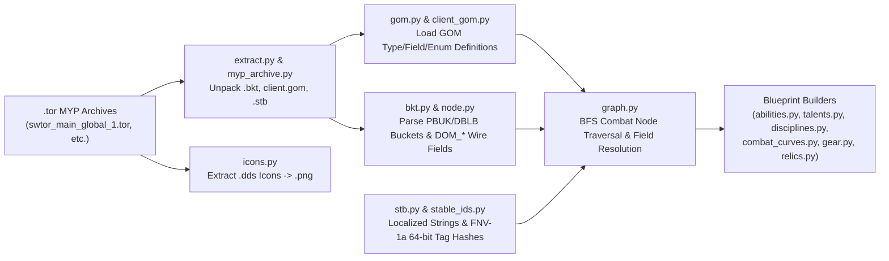

# SWTOR Game Data Extractor & JSON Schemas

**SwtorSim** includes a standalone binary extractor (`src/extractor/`) that reads *Star Wars: The Old Republic* `.tor` (MYP) archive files, decodes the Game Object Model (GOM), and builds the human-readable JSON blueprints consumed by the simulation engine.

---

## 1. Extractor Architecture & Pipeline



### Pipeline Stages (`src/extractor/cli.py :: run_pipeline`)

1. **Hash Dictionary & GOM Symbol Cache** (`hashlist.py`, `gom_cache.py`, `stable_ids.py`):
   - Downloads and caches the Jedipedia filename hash dictionary (`hashes.bin`), `gom.js` symbol map, and `fnv1a64.js` tag dictionary in `data/extractor/`.
   - **FNV-1a 64-bit Tag Hashing (`stable_ids.py :: fnv1a64`)**: SWTOR stores tag references (`tag.abl.*`, `tag.cbt.*`) as 64-bit FNV-1a hashes computed over uppercase UTF-16LE code units. `parse_tag_hashes()` precomputes `uint64 -> tag_string` so every numeric tag ID in GOM nodes resolves to its canonical string name.
2. **MYP Archive Unpacking** (`myp_archive.py`, `extract.py`):
   - Scans `Assets/*.tor` (`swtor_main_*.tor` or `swtor_test_*.tor` when `--pts` is passed).
   - Decompresses Zlib and Zstandard entries matching `buckets.info`, `client.gom`, `/systemgenerated/buckets/*.bkt`, and `/en-us/str/*.stb` into `data/extractor/extract_work/`.
3. **GOM Bucket Indexing & BFS Graph Traversal** (`bkt.py`, `node.py`, `graph.py`):
   - Parses `buckets.info` and indexes all `PBUK` / `DBLB` `.bkt` files into a `BucketStore`.
   - Seeds BFS traversal (`traverse_combat_graph`) with all root combat nodes (`apc.*`, `abl.*`, `tal.*`, `dis.*`, item equip abilities, relics, and adrenals) and follows combat reference fields (`COMBAT_REF_FIELD_IDS`) to decode every reachable node (`ParsedNode`) and resolve its fields (`resolve_fields`) against `GomLookup`, `.stb` string tables (`StringResolver`), and FNV-1a tag hashes.
4. **Raw Node Dump (Optional Reference)** (`dump.py`):
   - Writes raw resolved GOM nodes to `data/extractor/extracted/` (`nodes.json`, `edges.json`, and per-FQN JSON files).
5. **Simulator Blueprint Generation**:
   - **`disciplines.py`**: Builds `data/extractor/disciplines/<origin>/<spec>.json` with baseline active/passive ability lists and tier-by-tier `skill_tree` definitions.
   - **`abilities.py`**: Transforms `abl.*` nodes and their child `eff.*` effect sub-nodes into `data/extractor/parsed/abl/...`, scaling item-rating-dependent relic/adrenal effects via `cbtStandardRatingInfo` (`standard_rating.py`).
   - **`talents.py`**: Transforms `tal.*` nodes into `data/extractor/parsed/tal/...`.
   - **`gear.py`, `relics.py`, `adrenals.py`**: Writes `gear_abilities_talents.json`, `relics.json`, and `adrenals.json`.
   - **`combat_curves.py`**: Extracts `combat_curves.json` across all levels (`1` to `80` on Live, `1` to `85` on PTS).
6. **Icon Extraction** (`icons.py`):
   - Reads `.dds` textures from `*gfx_assets*.tor` for every icon referenced by parsed abilities/talents and converts them to `.png` in `data/extractor/icons/`.

---

## 2. Running the Extractor

### Interactive Wrapper

```powershell
.\.venv\Scripts\python.exe run_extractor.py
```

### Direct CLI (`src/extractor/main.py`)

```powershell
.\.venv\Scripts\python.exe src/extractor/main.py "<PATH_TO_SWTOR_ASSETS>" [options]
```

| Flag | Default | Description |
| :--- | :--- | :--- |
| `assets_path` | *(Positional)* | Path to SWTOR's `Assets` folder containing `.tor` files (optional if `--skip-extract` is used). |
| `--pts` | `False` | Reads `swtor_test_*.tor` archives, outputs to `data/extractor/pts/`, and defaults `--item-rating` to `362` (Level 85). |
| `--item-rating` | `344` (`362` on PTS) | Item rating used to resolve `cbtStandardRatingInfo` stat budgets for relics and adrenals. |
| `--skip-extract` | `False` | Reuses previously unpacked files in `extract_work/` without reading `.tor` archives. |
| `--skip-icons` | `False` | Skips `.dds` -> `.png` icon extraction. |
| `--keep-work` | `False` | Retains `extract_work/` after the pipeline finishes. |
| `--keep-extracted` | `False` | Retains raw `extracted/` node dumps after `parsed/` blueprints are built. |
| `--force-hash-update` | `False` | Forces re-downloading `hashes_filename.txt`, `gom.js`, and `fnv1a64.js` from Jedipedia. |

---

## 3. Parsed JSON Blueprint Schemas

### 3.1 Discipline Schema (`data/extractor/disciplines/<origin>/<spec>.json`)

Defines a class discipline, its baseline active and passive abilities, and its 8-tier skill tree (`level_23` through `level_73`).

```json
{
  "origin_story": "sith_inquisitor",
  "class_name": "Assassin",
  "discipline_name": "Hatred",
  "discipline_fqn": "dis.sith_inquisitor.assassin.hatred",
  "apc_fqn": "apc.sith_inquisitor.assassin.hatred",
  "active_abilities": [
    "abl.sith_inquisitor.assassinate",
    "abl.sith_inquisitor.creeping_terror",
    "abl.sith_inquisitor.discharge"
  ],
  "passive_abilities": [
    "abl.sith_inquisitor.skill.hatred.crackling_charge",
    "tal.sith_inquisitor.skill.hatred.fading_light"
  ],
  "skill_tree": {
    "level_23": {
      "option_1": {
        "fqn": "abl.sith_inquisitor.skill.hatred.demolish",
        "name": "Demolish",
        "icon": "abl_si_as_demolish",
        "replaces": "abl.sith_inquisitor.crushing_darkness"
      },
      "option_2": {
        "fqn": "tal.sith_inquisitor.skill.hatred.propagating_terror",
        "name": "Propagating Terror"
      },
      "option_3": {
        "fqn": "tal.sith_inquisitor.skill.hatred.Audacity",
        "name": "Audacity"
      }
    }
  }
}
```

---

### 3.2 Ability Blueprint Schema (`data/extractor/parsed/abl/**/*.json`)

Represents either an `"active"` castable ability or a `"passive"` ability package/proc/tactical/implant/relic.

```json
{
  "fqn": "abl.sith_inquisitor.skill.hatred.demolish",
  "name": "Demolish",
  "icon": "abl_si_as_demolish",
  "type": "active",
  "energy_cost": 25,
  "base_gcd": 1.5,
  "cooldown": 0.0,
  "triggers_gcd": true,
  "max_charges": null,
  "ablIgnoreAlacrity": false,
  "activation": {
    "type": "cast",
    "duration": 1.5
  },
  "tags": [
    "tag.abl.Attack.force",
    "tag.abl.utility.aggressive_action"
  ],
  "conditions": {},
  "stat_changes": [],
  "effects": [
    {
      "number": 1,
      "entry": true,
      "name": "Demolish",
      "icon": "abl_si_as_demolish",
      "duration": 6.0,
      "tick_interval": 1.0,
      "effIgnoreAlacrity": false,
      "tags": [
        "tag.abl.debuff.damage_over_time"
      ],
      "stack_charge": {
        "initial_stack_charge": 1,
        "max_stack_charge": 1,
        "scales_with_stack_charge": false
      },
      "initializers": [
        {
          "initializer_type": "modify_stat",
          "stat": "stat_cbt_damage_taken_scale_channel_force_modifier_percentage",
          "value": 0.05,
          "is_percent": true
        }
      ],
      "target_overrides": [],
      "conditions": {},
      "branches": [
        {
          "index": 1,
          "is_attack": true,
          "triggers": [
            {
              "trigger": "on_apply"
            }
          ],
          "conditions": {},
          "target_overrides": [],
          "run_if_none_ran": [],
          "actions": [
            {
              "action_type": "damage",
              "attack_type": 3,
              "damage_type": 4,
              "details": [
                {
                  "coefficient": 1.65,
                  "standard_health_percent_min": 0.165,
                  "standard_health_percent_max": 0.165,
                  "amount_modifier_percent": 0.0,
                  "is_offhand": false
                }
              ]
            }
          ]
        }
      ]
    }
  ]
}
```

#### Key `Effect`, `Branch`, and `Action` Fields

- **`effects[].entry` (`bool`)**: If `True`, this effect executes automatically when the ability is cast (or when its cast-time completes). Non-entry effects (`"entry": false`) are invoked by `"apply_effect"` actions from other branches.
- **`effects[].duration` (`float`) & `initializers`**: If `duration > 0` or `initializers` contains `eff_initializer__set_passive`, the effect persists on the target actor as an `ActiveEffect`. Otherwise it resolves instantaneously.
- **`branches[].triggers`**:
  - Lifecycle triggers (`on_apply`, `on_refresh`, `on_tick`, `on_pre_remove`, `on_timer_expired`, `on_travel_complete`, `on_stack_charge_increased`, `on_stack_charge_decreased`).
  - Event-bus proc triggers (`on_damage_dealt`, `on_ability_activate`, `on_ability_post_activate`, `on_enter_combat`, etc.) with optional `chance`, `intervals.interval_61` (ICD in seconds), `tags`, `ability_spec`, `results`, `spell_types`, `damage_types`, and `weapon_mode`.
- **`branches[].run_if_none_ran` (`list[int]`)**: Fallback gate—skips this branch if any branch whose `index` is listed already ran during the same trigger evaluation.
- **`actions[].results` (`list[str]`)**: Gates follow-up actions in the same branch on the outcome of preceding `"damage"` actions (e.g. `["effResultCrit"]` or `["effResultOk", "effResultGlance", "effResultCrit"]`).

---

### 3.3 Talent Blueprint Schema (`data/extractor/parsed/tal/**/*.json`)

Talent (`tal.*`) blueprints provide passive stat modifications (`stat_changes`) that either apply globally or target specific ability FQNs/tags (`targets`).

```json
{
  "fqn": "tal.sith_inquisitor.skill.hatred.fading_light",
  "name": "Fading Light",
  "type": "passive",
  "ranks": 1,
  "stat_changes": [
    {
      "stat": "stat_cbt_damage_dealt_scale_tag_modifier_percentage",
      "value": 0.05,
      "is_percent": true,
      "targets": [
        "tag.abl.sith_inquisitor.periodic_damage"
      ]
    }
  ]
}
```

> [!IMPORTANT]
> **Percentage Representation Rule (`AGENTS.md` Rule 2)**:
> All percentage values in parsed blueprints (`is_percent: true`) are stored as canonical decimal fractions (e.g., `0.05` = `+5%`, `-0.20` = `-20%`). Never divide or multiply them heuristically.

---

### 3.4 Combat Curves Schema (`data/extractor/combat_curves.json`)

Stores the extracted `derived_stat_curves` (`Cap` and `Divisor` per rating->stat mapping) and per-level rows (`1`..`80` on Live, `1`..`85` on PTS) containing `stat_modifiers`, `armor` constants, and `standard_damage` / `standard_healing` budgets.

```json
{
  "derived_stat_curves": {
    "STAT_rtg_crit": [
      {
        "target_stat": "STAT_cbt_crit_chance",
        "cap": 0.3,
        "divisor": 20.0,
        "modifier_spec": "STAT_rtg_crit"
      }
    ]
  },
  "levels": {
    "80": {
      "stat_modifiers": {
        "STAT_rtg_crit": 12.0564,
        "STAT_rtg_alacrity": 16.0752,
        "STAT_rtg_accuracy": 16.0752,
        "STAT_att_mastery": 27.162125
      },
      "armor": {
        "additive": 8000.0,
        "multiplier": 199.89999389648438
      },
      "standard_damage": {
        "player": 20125.0,
        "boss_raid": 20125.0
      }
    }
  }
}
```
